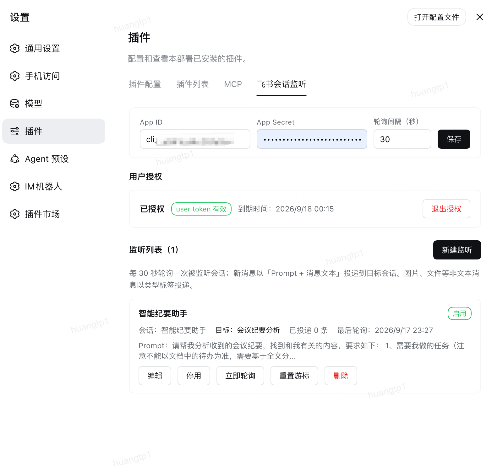

<div align="center">

# dsh-lark-session-monitor-plugin

**用你自己的飞书账号盯群，新消息自动转进 DSH 会话接着处理。**

[详细说明](./README.zh-CN.md) · [English](./README.en.md)



</div>

## 这是什么

一个 [DeepSeek Harness（DSH）](https://github.com/lifeopsgo)插件。飞书会话里来了新消息，它就把消息转给你指定的 DSH 会话，AI 按你写的提示词接着处理。

比如：把「客诉群」交给它盯着，有人反馈问题，AI 会话自动收到并按你定的流程总结——你不用一直刷群。

## 它能干什么

- 用**你自己的飞书身份**读会话，私聊、群聊都行
- 新消息自动转进指定的 DSH 会话，一次最多带 10 条，每条带发送人和消息 ID
- 转发前先带上你写的提示词，比如「这是客诉，请按流程总结」
- 可以只盯某几个人，也可以只盯 @机器人 的消息，支持关键词黑白名单
- 可以跳过你自己发的消息，不自己转自己
- 只读不写：不会往飞书发任何东西
- 同时开两个 DSH 也不会把同一批消息转两遍（v2.3.0 起）

## 安装

要求 Node.js ≥ 22.6、DSH ≥ 0.2.0-rc.1。

```bash
dsh plugin --profile web add github:lifeopsgo/dsh-lark-session-monitor-plugin#v2.3.0
```

重启 DSH、刷新页面，进 **设置 → 插件 → 飞书会话监听**。

升级：把命令里的版本号换成新版再跑一遍。卸载：

```bash
dsh plugin --profile web remove dsh-lark-session-monitor-plugin
```

## 三步配好

1. **建飞书应用**：到[飞书开放平台](https://open.feishu.cn/app)建一个自建应用，开通 4 个用户权限（读私聊、读群聊、读会话名、免重复授权），把 App ID 和 App Secret 填进设置页。
2. **授权**：点「开始授权」，在飞书里点同意，回来点「我已完成授权」。
3. **新建监听**：选要盯的飞书会话、写一句提示词、选消息要转去的 DSH 会话（留空就自动新建）。保存后它就开始盯了。

**隐私一句话**：App Secret 和授权 token 都存在你本机的 DSH 里，不外传、无遥测；插件只读你配置的会话。

## 更多细节

每个字段是什么意思、消息怎么转、多个 DSH 实例怎么互斥、已知限制，见[详细说明](./README.zh-CN.md)。

## 许可证

MIT — 见 [LICENSE](./LICENSE)。
